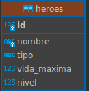

# Flujo de la opcion "Insertar heroe": View -> Controller -> DAO -> BD

```
 USUARIO            VIEW                CONTROLLER             DAO               ConexionDB            MySQL
 (teclado)        HeroeUI            HeroeController         HeroeDAO            (config.txt)        rpg_grupal_db
    |                 |                      |                    |                    |                   |
    | opcion 9 -> 1   |                      |                    |                    |                   |
    |---------------->|                      |                    |                    |                   |
    | nombre, tipo,   |                      |                    |                    |                   |
    | vida, nivel     |                      |                    |                    |                   |
    |---------------->|                      |                    |                    |                   |
    |                 | insertar(nombre,     |                    |                    |                   |
    |                 |   tipo, vida, nivel) |                    |                    |                   |
    |                 |--------------------->|                    |                    |                   |
    |                 |                      | 1. VALIDA:         |                    |                   |
    |                 |                      |  nombre no vacio,  |                    |                   |
    |                 |                      |  <= 15, solo       |                    |                   |
    |                 |                      |  letras/numeros;   |                    |                   |
    |                 |                      |  tipo valido;      |                    |                   |
    |                 |                      |  vida > 0; nivel>=1|                    |                   |
    |                 |                      |  (si falla: devuelve Resultado.error   |                   |
    |                 |                      |   y NO llega al DAO)                   |                   |
    |                 |                      | 2. new Heroe(...)  |                    |                   |
    |                 |                      | insertar(heroe)    |                    |                   |
    |                 |                      |------------------->|                    |                   |
    |                 |                      |                    | obtenerConexion()  |                   |
    |                 |                      |                    |------------------->|                   |
    |                 |                      |                    |                    | lee config.txt    |
    |                 |                      |                    |                    | (BufferedReader)  |
    |                 |                      |                    |                    | getConnection(    |
    |                 |                      |                    |                    |  url,usuario,clave)|
    |                 |                      |                    |                    |------------------>|
    |                 |                      |                    |<-- Connection -----|<------------------|
    |                 |                      |                    | prepareStatement(  |                   |
    |                 |                      |                    |  "INSERT ... (?,?,?,?)")                |
    |                 |                      |                    | setString/setInt   |                   |
    |                 |                      |                    | executeUpdate() ------------------------>|
    |                 |                      |                    |<------------------------ 1 fila, id=N ---|
    |                 |                      |                    | heroe.setId(N)     |                   |
    |                 |                      |                    | cierra ResultSet,  |                   |
    |                 |                      |                    | PreparedStatement, |                   |
    |                 |                      |                    | Connection (try-with-resources)        |
    |                 |                      |<-- filas = 1 ------|                    |                   |
    |                 |                      | 3. decide mensaje: |                    |                   |
    |                 |                      | "Heroe X guardado  |                    |                   |
    |                 |<-- Resultado.ok -----|   con el id N."    |                    |                   |
    |                 | imprime el mensaje   |                    |                    |                   |
    |<----------------|                      |                    |                    |                   |
```

## Caminos de error (nunca llegan como traza al usuario)

| Situacion | Quien lo detecta | Como termina |
|---|---|---|
| Nombre vacio, tipo invalido, vida <= 0, nivel < 1 | Controller | `Resultado.error(...)`, no se llama al DAO |
| Nombre repetido (error MySQL 1062) | DAO | `NombreDuplicadoException` -> Controller -> "Ya existe un heroe llamado X" |
| Falta `config.txt` o una clave | ConexionDB | `DaoException` -> Controller -> View; no se intenta conectar |
| MySQL apagado / clave mala / BD inexistente | ConexionDB | `DaoException` con mensaje claro |
| Cualquier otro `SQLException` | DAO | `DaoException` con el mensaje del error |

## Quien puede ver que (regla MVC)

```
View  --usa-->  Controller  --usa-->  DAO  --usa-->  ConexionDB  -->  MySQL
 (Scanner,       (valida, decide        (unico con       (unico que lee
  System.out)     el mensaje)            JDBC)            config.txt)
```
La View nunca importa `java.sql` ni `dao`; el Controller nunca importa `java.sql`; el `Main` solo llama a `new HeroeUI(scanner).iniciar()`.
